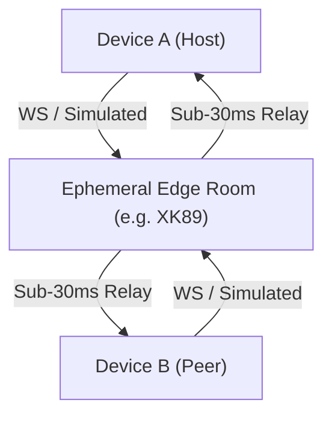

# Room Relay (`@some-alambre/room-relay`)

The `@some-alambre/room-relay` package provides a lightweight, headless ephemeral room synchronization engine designed for real-time multi-device local/casual multiplayer, companion displays, and collaborative interfaces in mobile apps.

It eliminates the fragility and discovery barriers of traditional local LAN networking while avoiding heavyweight database backends.

---

## 1. Architectural Philosophy



### Why Room Relay over Traditional Local LAN?
1. **Zero Discovery Barriers:** Local LAN multiplayer requires Bonjour, mDNS, UDP broadcast, or SSDP. In modern mobile OSs (iOS 14+ local network permission prompt, Android 11+ AP isolation, multi-band WiFi router segregation), device discovery silently fails over 40% of the time. Room relay uses an ephemeral 4-character room code (e.g. `XK89`), connecting immediately across WiFi, 5G, or cellular without permission prompts.
2. **Sub-30ms Round-Trip Time:** Ephemeral edge workers (e.g., Cloudflare Durable Objects, PartyKit, Fly.io) maintain state entirely in RAM at the nearest edge pop. No database round-trips, no disk writes.
3. **Dual Transport Architecture:** Features `SimulatedRelayTransport` for instant offline development, multi-peer testing inside a single testbed or simulator, and headless unit tests with zero mock servers or network adapters.
4. **Resilient Connection Lifecycle:** Built-in exponential backoff with jitter, heartbeat watchdog detecting half-open socket drops, and intentional disconnect tracking preventing reconnection loops.

---

## 2. Public API Surface

### 2.1 Room Code Generation
```ts
import { generateRoomCode, sanitizeRoomCode } from "@some-alambre/room-relay";

// Generates 4-char code without ambiguous characters (I, 1, O, 0)
const code = generateRoomCode(); // e.g. "XK89"

// Sanitizes user input (trims, uppercases)
const clean = sanitizeRoomCode("  xk89  "); // "XK89"
```

### 2.2 Headless Client (`RoomRelayClient`)
Pure TypeScript class usable in React, Node, or background tasks without React test harnesses:

```ts
import { createRoomRelay } from "@some-alambre/room-relay";

type GameEvents = {
  CARD_PLAYED: { cardId: string; x: number; y: number };
  TURN_ENDED: { nextPlayerId: string };
};

const client = createRoomRelay<GameEvents>({
  roomCode: "XK89",
  playerName: "Alice",
  mode: "simulated", // or "websocket"
  serverUrl: "wss://relay.alambre.party/room",
  autoConnect: true,
});

// Event subscription without React re-render overhead
const unsub = client.on("CARD_PLAYED", (payload, msg) => {
  console.log("Card played by", msg.from, payload.cardId);
});

// Dispatch typed message
client.send("CARD_PLAYED", { cardId: "ace_spades", x: 120, y: 340 });

// Atomic room lifecycle methods (unifies transport connection with room entry/exit)
client.join("XK89");        // Cleans up previous session and connects directly to room
client.create();            // Generates 4-letter code, designates as Host, and connects
client.leave();             // Disconnects cleanly, clears peers, and returns to idle
client.setServerUrl("ws://192.168.1.14:8787"); // Dynamically updates target and reconnects
```

### 2.3 React Hook (`useRoomRelay`)
Synchronized via `useSyncExternalStore` for tearing-free rendering:

```tsx
import { useRoomRelay, useRoomRelaySelector } from "@some-alambre/room-relay";

function MultiplayerGame() {
  const relay = useRoomRelay({
    playerName: "Alice",
    mode: "websocket",
    serverUrl: "ws://192.168.1.14:8787",
    autoConnect: false, // Sit in lobby until join() or create() is called
  });

  if (relay.status === "idle" || relay.status === "disconnected") {
    return (
      <View>
        <Button title="Create Room" onPress={() => relay.create()} />
        <Button title="Join XK89" onPress={() => relay.join("XK89")} />
      </View>
    );
  }

  return (
    <View>
      <Text>Room: #{relay.roomCode} ({relay.isHost ? "Host" : "Guest"})</Text>
      <Text>Status: {relay.status} ({relay.latency}ms)</Text>
      <Text>Peers: {relay.peers.length}</Text>
      <Button title="Play Card" onPress={() => relay.send("CARD_PLAYED", { cardId: "c1" })} />
      <Button title="Leave Room" onPress={() => relay.leave()} />
    </View>
  );
}

// Selective subscription for high-frequency latency or peer counters:
function PingBadge({ client }) {
  const latency = useRoomRelaySelector(client, state => state.latency);
  return <Text>{latency} ms</Text>;
}
```

---

## 3. Transports

### `SimulatedRelayTransport`
In-memory simulated edge relay hub. Allows running multiple virtual clients in parallel:
```ts
import { SimulatedRelayTransport, createSimulatedRelayHub } from "@some-alambre/room-relay";

// Create isolated hub for unit tests
const testHub = createSimulatedRelayHub();

const transport = new SimulatedRelayTransport({
  id: "p1",
  name: "Alice",
  roomCode: "TEST",
  isHost: true,
  latencyMs: 15,
  hub: testHub,
});
```

### `WebSocketRelayTransport`
Edge WebSocket transport supporting standard WebSocket schema:
```ts
import { WebSocketRelayTransport } from "@some-alambre/room-relay";

const transport = new WebSocketRelayTransport({
  url: "wss://relay.alambre.party/room",
  id: "p1",
  name: "Alice",
  roomCode: "XK89",
  isHost: true,
  autoReconnect: true,
  initialRetryDelayMs: 1000,
  maxRetryDelayMs: 15000,
  backoffFactor: 1.5,
});
```

---

## Deterministic Seeded PRNG & Shuffling

For verifiable fair shuffles, deterministic match replays, and reproducible Vitest multiplayer tests, `@some-alambre/room-relay` provides a zero-dependency 32-bit seeded PRNG (Mulberry32) and Fisher-Yates shuffle:

```ts
import { hashSeed, createSeededRng, shuffleWithSeed } from "@some-alambre/room-relay";

const rng = createSeededRng("ROOM_XK89_ROUND_1");
const nextFloat = rng(); // [0, 1)

// Non-mutating deterministic Fisher-Yates shuffle:
const shuffledDeck = shuffleWithSeed(deck, "ROOM_XK89_ROUND_1");
```

---

## Authoritative Turn Engine (`createTurnEngine`, `useTurnEngine`)

`TurnEngineClient` and `useTurnEngine<TState, TAction>` wrap `RoomRelayClient` with a reducer-driven, host-authoritative state machine featuring:
- **Host Arbitration & Monotonic Sequencing (`seq`):** Guest `dispatch(action)` calls send `TURN_ACTION_INTENT` to the host; the host validates via `validateAction`, increments `seq`, runs `reducer(state, action, meta)`, and broadcasts `TURN_ACTION_COMMIT`.
- **Automatic Late-Join & Reconnect Snapshot Sync:** Guests automatically emit `TURN_SYNC_REQUEST` upon connection or sequence gap detection and hydrate from the host's `TURN_SYNC_SNAPSHOT`.
- **Optional Turn Countdown Timer:** Built-in `turnDurationMs`, `remainingTurnMs`, and host `onTurnTimeout` handler.

```tsx
import { useTurnEngine } from "@some-alambre/room-relay";

const turn = useTurnEngine<GameState, GameAction>({
  roomCode: "XK89",
  playerName: "Alice",
  isHost: true,
  mode: "simulated",
  initialState: createInitialState(),
  reducer: (state, action, meta) => applyAction(state, action, meta.seq),
  turnDurationMs: 30000,
});

// Dispatch an action (commits on host, sends intent on guest):
turn.dispatch({ type: "PLAY_CARD", cardId: "c_spades_A" });
```

---

## 5. Web Providers & Edge Deployment (PartyKit / Cloudflare)

When moving beyond local development, `@some-alambre/room-relay` connects to serverless edge WebSockets (e.g. PartyKit on Cloudflare Workers):

### 5.1 Environment Configuration (Expo)
In Expo / React Native applications, expose the public relay WebSocket endpoint using the `EXPO_PUBLIC_` prefix in `.env` (automatically bundled without native rebuilds):

```env
# .env
EXPO_PUBLIC_RELAY_URL=wss://relay.alambre.party/room
```

```tsx
const relay = useRoomRelay({
  roomCode: "XK89",
  playerName: "Alice",
  mode: "websocket",
  serverUrl: process.env.EXPO_PUBLIC_RELAY_URL ?? "wss://relay.alambre.party/room",
});
```

### 5.2 PartyKit Edge Server
The repository includes an edge worker template under `packages/room-relay/partykit/`:
- `server.ts`: Handles room routing, ephemeral peer presence, and sub-30ms message broadcasting.
- `partykit.json`: Configuration deploying instantly with `npx partykit deploy`.

### 5.3 PartyKit Runtime State

When running the PartyKit dev server locally (`npx partykit dev`), it persists ephemeral state as SQLite files under:

```
packages/room-relay/partykit/.partykit/state/party/
```

These are **runtime artifacts** and must **not** be version-controlled. The `.gitignore` already excludes the entire `.partykit/` directory. To reset the local state, delete the contents:

```bash
rm -rf packages/room-relay/partykit/.partykit/state/party/*
```


