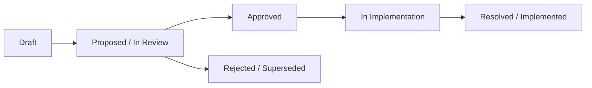

# Alambre Architecture Proposals (RFCs)

Welcome to the architectural proposal repository for the **Alambre** monorepo. This directory houses Request for Comments (RFCs), design specifications, and post-implementation audits for changes spanning `packages/alambre`, `@alambre/ui`, `@alambre/room-relay`, and consumer testbeds (`apps/playground`, `apps/base-template`).

---

## 🚦 Proposal Lifecycle

1. **Draft / Proposed**: The proposal defines the problem, architectural principles, API contract, and concrete code changes.
2. **Review & Audit**: Evaluated against headless boundaries, web/native parity, type safety, and zero external runtime bloat.
3. **Implementation**: Solely authored in production code by `@lead`.
4. **Validation & Extraction Audit**: Audited by `@reviewer` for boundaries/leaks, verified with tests authored by `@tester`, and gated by `pnpm validate`.

---

## 📋 Executive Status Registry

| RFC | Title | Scope | Status | Summary |
| :--- | :--- | :--- | :---: | :--- |
| **[RFC-0001](./0001-headless-modal-bottom-sheet.md)** | Headless Modal & Bottom Sheet Primitives | `alambre/behaviors` | `RESOLVED` | Headless overlay primitives `useDialog`, `useBottomSheet` & compound dialogs. |
| **[RFC-0002](./0002-compound-form-primitives.md)** | Compound Form Primitives & Focus Chaining | `alambre/components` | `RESOLVED` | Compound primitives `Input`, `Stepper`, and `Slider` with native focus chaining. |
| **[RFC-0003](./0003-wheel-picker-physics.md)** | Retiring `TimePicker` into Wheel Physics | `alambre/behaviors` | `RESOLVED` | Replaced legacy `TimePicker` with headless `useWheelPicker` & `HorizontalPicker`. |
| **[RFC-0004](./0004-type-safety-state-modernization.md)** | First-Class Type Safety & State Modernization | `alambre/core` | `RESOLVED` | Typed `createConfig`, `useNavigator<TRoute, TSubpage>`, and `createLang`. |
| **[RFC-0005](./0005-headless-swipe-to-action.md)** | Formalizing Headless Swipe-to-Action | `alambre/hooks` | `RESOLVED` | Tactile swipe-to-reveal action row primitive `useSwipeableRow`. |
| **[RFC-0006](./0006-traveling-wavefront-kinetics.md)** | Traveling Wavefront & Kinetic Orchestration | `alambre/kinetics` | `RESOLVED` | Worklet-driven `useWavefront` with closed-form damping curves. |
| **[RFC-0007](./0007-declarative-wavefront-tactile-kinetics.md)** | Declarative Wavefront & Tactile Kinetics | `alambre/kinetics` | `RESOLVED` | `<WavefrontProvider>`, `useWavefrontItem`, and universal `usePressKinetics`. |
| **[RFC-0008](./0008-spatial-flight-kinetics.md)** | Spatial & Ballistic Flight Kinetics | `alambre/kinetics` | `RESOLVED` | 3D card flips (`useSpatialFlip`) and flight trajectories (`useFlightTrajectory`). |
| **[RFC-0009](./0009-kinetic-containers-dual-gesture.md)** | Kinetic Containers & Dual-Gesture Swipe | `alambre/behaviors` | `RESOLVED` | Smooth multi-directional pan containers `useKineticSwipe` and `useKineticCarousel`. |
| **[RFC-0010](./0010-headless-ephemeral-room-relay.md)** | Headless Ephemeral Room Relay | `alambre/relay` | `RESOLVED` | Ephemeral multiplayer session synchronization & simulated transport. |
| **[RFC-0011](./0011-kinetic-pipeline-multi-track.md)** | Kinetic Pipeline & Multi-Track Choreography | `alambre/kinetics` | `RESOLVED` | Composite animation sequencing via `useKineticPipeline` and `useKineticChoreography`. |
| **[RFC-0012](./0012-spatial-coordinate-space-target-registry.md)** | Spatial Coordinate Space & Toss Physics | `alambre/kinetics` | `RESOLVED` | Global coordinate registry `<SpatialSpace>`, `useSpatialTarget`, and `useSpatialToss`. |
| **[RFC-0013](./0013-cascading-deal-unified-interactive-hand.md)** | UI-Thread Cascading Deal & Interactive Hand | `alambre/kinetics` | `RESOLVED` | High-performance cascade card dealing and reorderable fan `useInteractiveHand`. |
| **[RFC-0014](./0014-deterministic-turn-engine-seeded-prng.md)** | Deterministic Turn Engine & Seeded PRNG | `alambre/relay` | `RESOLVED` | Seeded PRNG (`createSeededRng`), deterministic shuffling, and `useTurnEngine`. |
| **[RFC-0015](./0015-headless-sensory-cues-tactile-feedback.md)** | Headless Sensory Cues & Audio/Haptics | `alambre/capabilities` | `RESOLVED` | Reactive sensory cue store `createSensoryCues` with cooldown throttling & muting. |
| **[RFC-0016](./0016-ui-consolidation-theme-provider.md)** | `@alambre/ui` Consolidation & Hygiene | `alambre/ui` | `RESOLVED` | Unified tactile component library, `<ThemeProvider>`, and demo cleanup. |
| **[RFC-0017](./0017-core-store-navigator-resilience.md)** | Core Store Unification & Navigation Guards | `alambre/core` | `RESOLVED` | Unified `createStore`, resilient `useNavigator`, and sync/async `useNavigationGuard`. |
| **[RFC-0018](./0018-zero-context-apptoast-token-migration.md)** | Zero-Context `AppToast` & Token Migration | `alambre/ui` | `RESOLVED` | Headless `toast` dispatcher, promoted `AppToast`, and token cleanup. |
| **[RFC-0019](./0019-strict-headless-forms-architecture.md)** | Strict Headless Forms & Granular Subscriptions | `alambre/capabilities` | `PROPOSED` | Type-safe form engine `createForm`, `useField`, and `getFieldProps`. |
| **[RFC-0020](./0020-multiplayer-fog-of-war-host-migration.md)** | Multiplayer Fog-of-War & Host Migration | `alambre/relay` | `PROPOSED` | View projection masks, optimistic action resolution, and host handover. |
| **[RFC-0021](./0021-declarative-sensory-kinetics-kinetic-tabs.md)** | Declarative Sensory Kinetics & Kinetic Tabs | `alambre/kinetics` | `PROPOSED` | Auto-triggered sensory cues, sliding `useKineticTabs`, and `SortableList`. |

---

## 🗂️ Thematic Categories

### 1. Core State & Application Navigation
- **[RFC-0004: First-Class Type Safety & State Modernization](./0004-type-safety-state-modernization.md)**
- **[RFC-0017: Core Store Unification, Navigator Resilience & Route Interception](./0017-core-store-navigator-resilience.md)**

### 2. Overlays, Dialogs & Notifications
- **[RFC-0001: Headless Modal & Bottom Sheet Primitives](./0001-headless-modal-bottom-sheet.md)**
- **[RFC-0018: Zero-Context `AppToast`, Presentation Boundary Cleanups & Semantic Token Migration](./0018-zero-context-apptoast-token-migration.md)**

### 3. Forms & Interaction Primitives
- **[RFC-0002: Compound Form Primitives & Focus Chaining Architecture](./0002-compound-form-primitives.md)**
- **[RFC-0003: Retiring the `TimePicker` Exception into Headless Wheel Physics](./0003-wheel-picker-physics.md)**
- **[RFC-0019: Strict Headless Forms Architecture & Granular Subscription](./0019-strict-headless-forms-architecture.md)**

### 4. Kinetics, Physics & Spatial Gestures
- **[RFC-0005: Formalizing the Headless Swipe-to-Action Primitive](./0005-headless-swipe-to-action.md)**
- **[RFC-0006: Traveling Wavefront & Kinetic Orchestration Architecture](./0006-traveling-wavefront-kinetics.md)**
- **[RFC-0007: Declarative Wavefront Orchestration & Headless Tactile Kinetics](./0007-declarative-wavefront-tactile-kinetics.md)**
- **[RFC-0008: Spatial & Flight Kinetics](./0008-spatial-flight-kinetics.md)**
- **[RFC-0009: Kinetic Containers & Dual-Gesture Swipe](./0009-kinetic-containers-dual-gesture.md)**
- **[RFC-0011: Headless Kinetic Pipeline & Multi-Track Choreography](./0011-kinetic-pipeline-multi-track.md)**
- **[RFC-0012: Headless Spatial Coordinate Space, Target Registry & Toss Physics](./0012-spatial-coordinate-space-target-registry.md)**
- **[RFC-0013: UI-Thread Cascading Deal & Unified Interactive Hand](./0013-cascading-deal-unified-interactive-hand.md)**
- **[RFC-0021: Declarative Sensory Kinetics, Kinetic Tabs & Headless Virtualized Sortable Lists](./0021-declarative-sensory-kinetics-kinetic-tabs.md)**

### 5. Multiplayer, Networking & Room Relay
- **[RFC-0010: Headless Ephemeral Room Relay](./0010-headless-ephemeral-room-relay.md)**
- **[RFC-0014: Deterministic Turn Engine, Seeded PRNG & State Snapshots](./0014-deterministic-turn-engine-seeded-prng.md)**
- **[RFC-0020: Multiplayer Fog-of-War, Optimistic Action Execution & Host Migration](./0020-multiplayer-fog-of-war-host-migration.md)**

### 6. Tactile Sensory & Design System
- **[RFC-0015: Headless Sensory Cues & Tactile Audio/Haptic Contract](./0015-headless-sensory-cues-tactile-feedback.md)**
- **[RFC-0016: `@alambre/ui` Consolidation, `ThemeProvider` Unification & Hygiene](./0016-ui-consolidation-theme-provider.md)**

---

## ✍️ Authoring & Implementation Conventions

When authoring a new proposal:
1. Allocate the next monotonic RFC number (e.g., `0022-slug.md`).
2. Add the frontmatter block specifying `id`, `title`, `status: PROPOSED`, `author`, `scope`, and `summary`.
3. Include clear sections:
   - **Problem Statement**: Concrete friction or boundary violations in current code.
   - **Proposed Architecture & API Contract**: TypeScript signatures, hook contracts, and component composition.
   - **Step-by-Step Implementation Plan**: Files created/modified, dependency updates, and consumer migrations.
   - **Verification Strategy**: Unit/contract tests, public API assertions, and manual or Maestro testbed validation.
4. Update this `index.md` registry.
5. On completion, invoke `@reviewer` for an architectural/boundary audit and `@tester` for test coverage, followed by running `pnpm validate`.
