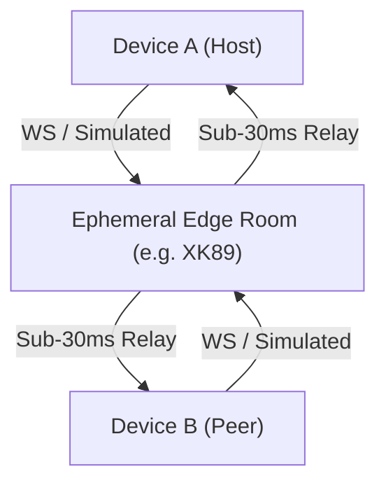

# Room Relay (`@alambre/room-relay`)

The `@alambre/room-relay` package provides a lightweight, headless ephemeral room synchronization engine designed for real-time multi-device local/casual multiplayer, companion displays, and collaborative interfaces in mobile apps.

It eliminates the fragility and discovery barriers of traditional local LAN networking while avoiding heavyweight database backends.

---

## 1. Architectural Philosophy



### Why Room Relay over Traditional Local LAN?
1. **Zero Discovery Barriers:** Local LAN multiplayer requires Bonjour, mDNS, UDP broadcast, or SSDP. In modern mobile OSs (iOS 14+ local network permission prompt, Android 11+ AP isolation, multi-band WiFi router segregation), device discovery silently fails over 40% of the time. Room relay uses an ephemeral 4-character room code (e.g. `XK89`), connecting immediately across WiFi, 5G, or cellular without permission prompts.
2. **Sub-30ms Round-Trip Time:** Ephemeral edge workers (e.g., Cloudflare Durable Objects, PartyKit, Fly.io) maintain state entirely in RAM at the nearest edge pop. No database round-trips, no disk writes.
3. **Dual Transport Architecture:** Features `SimulatedRelayTransport` for instant offline development, multi-peer testing inside a single testbed or simulator, and headless unit tests with zero mock servers or network adapters.
4. **Resilient Connection Lifecycle:** Built-in exponential backoff with jitter, heartbeat watchdog detecting half-open socket drops, and intentional disconnect tracking preventing reconnection loops.

---

## 2. Public API Surface

### 2.1 Room Code Generation
```ts
import { generateRoomCode, sanitizeRoomCode } from "@alambre/room-relay";

// Generates 4-char code without ambiguous characters (I, 1, O, 0)
const code = generateRoomCode(); // e.g. "XK89"

// Sanitizes user input (trims, uppercases)
const clean = sanitizeRoomCode("  xk89  "); // "XK89"
```

### 2.2 Headless Client (`RoomRelayClient`)
Pure TypeScript class usable in React, Node, or background tasks without React test harnesses:

```ts
import { createRoomRelay } from "@alambre/room-relay";

type GameEvents = {
  CARD_PLAYED: { cardId: string; x: number; y: number };
  TURN_ENDED: { nextPlayerId: string };
};

const client = createRoomRelay<GameEvents>({
  roomCode: "XK89",
  playerName: "Alice",
  mode: "simulated", // or "websocket"
  serverUrl: "wss://relay.alambre.party/room",
  autoConnect: true,
});

// Event subscription without React re-render overhead
const unsub = client.on("CARD_PLAYED", (payload, msg) => {
  console.log("Card played by", msg.from, payload.cardId);
});

// Dispatch typed message
client.send("CARD_PLAYED", { cardId: "ace_spades", x: 120, y: 340 });

// Atomic room management
client.joinRoom("GUEST2");
client.createRoom(); // creates new random code and reconnects
```

### 2.3 React Hook (`useRoomRelay`)
Synchronized via `useSyncExternalStore` for tearing-free rendering:

```tsx
import { useRoomRelay, useRoomRelaySelector } from "@alambre/room-relay";

function MultiplayerGame() {
  const relay = useRoomRelay({
    roomCode: "XK89",
    playerName: "Alice",
    mode: "simulated",
  });

  return (
    <View>
      <Text>Room: {relay.roomCode}</Text>
      <Text>Status: {relay.status} ({relay.latency}ms)</Text>
      <Text>Peers: {relay.peers.length}</Text>
      <Button title="Play Card" onPress={() => relay.send("CARD_PLAYED", { cardId: "c1" })} />
    </View>
  );
}

// Selective subscription for high-frequency latency or peer counters:
function PingBadge({ client }) {
  const latency = useRoomRelaySelector(client, state => state.latency);
  return <Text>{latency} ms</Text>;
}
```

---

## 3. Transports

### `SimulatedRelayTransport`
In-memory simulated edge relay hub. Allows running multiple virtual clients in parallel:
```ts
import { SimulatedRelayTransport, createSimulatedRelayHub } from "@alambre/room-relay";

// Create isolated hub for unit tests
const testHub = createSimulatedRelayHub();

const transport = new SimulatedRelayTransport({
  id: "p1",
  name: "Alice",
  roomCode: "TEST",
  isHost: true,
  latencyMs: 15,
  hub: testHub,
});
```

### `WebSocketRelayTransport`
Edge WebSocket transport supporting standard WebSocket schema:
```ts
import { WebSocketRelayTransport } from "@alambre/room-relay";

const transport = new WebSocketRelayTransport({
  url: "wss://relay.alambre.party/room",
  id: "p1",
  name: "Alice",
  roomCode: "XK89",
  isHost: true,
  autoReconnect: true,
  initialRetryDelayMs: 1000,
  maxRetryDelayMs: 15000,
  backoffFactor: 1.5,
});
```
